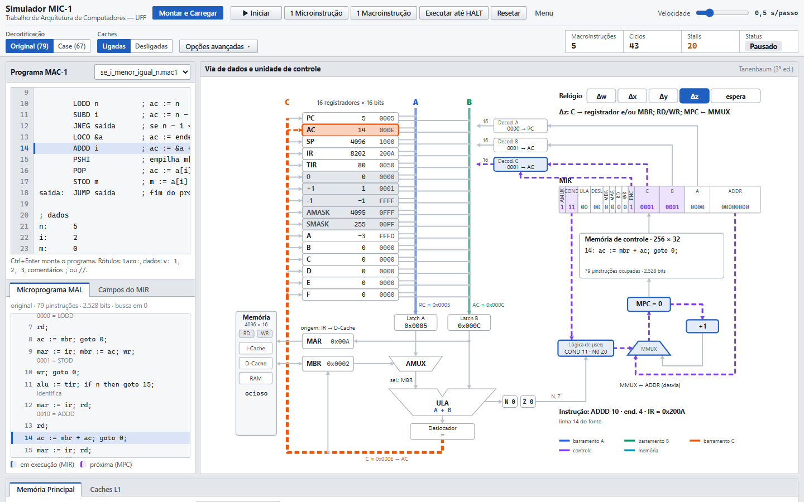
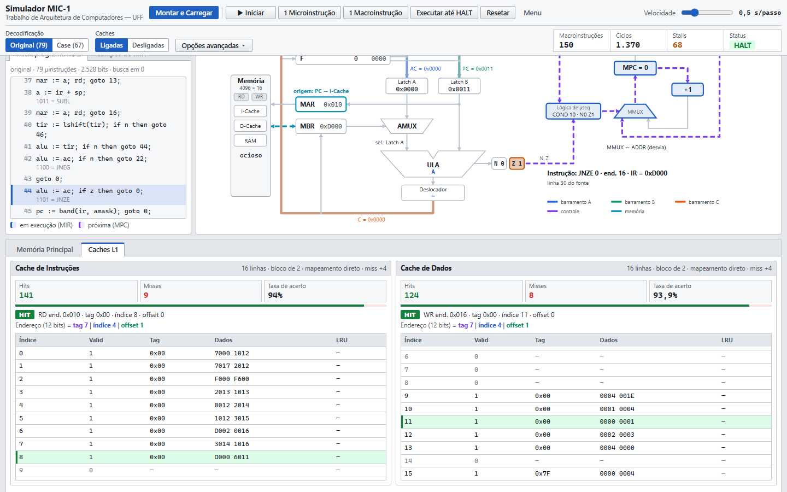

<div align="center">

# Simulador MIC-1

Simulador da microarquitetura MIC-1 com conjunto de instruções MAC-1




</div>

Este projeto implementa a máquina microprogramada de 16 bits do livro *Organização
Estruturada de Computadores*, de Andrew S. Tanenbaum (3ª edição). Dá para acompanhar cada
instrução subciclo a subciclo (Δw, Δx, Δy e Δz), comparar a unidade de controle original,
de 79 microinstruções, com uma versão de 67 microinstruções que pula direto para a rotina do
opcode, e medir o efeito de caches L1 separadas de instruções e de dados no tempo de
execução.

## O que é possível fazer

- Escrever programas em assembly MAC-1 com rótulos, variáveis e vetores (`a: 10, 20, 30`) e
  montar com um clique; os erros aparecem com o número da linha.
- Executar por subciclo, por microinstrução, por macroinstrução, em modo automático com
  velocidade ajustável ou direto até o fim do programa.
- Ver os barramentos A, B e C acendendo em cada subciclo, os 16 registradores em decimal e
  hexadecimal, a ULA com as flags N e Z, o deslocador, o MAR, o MBR e os 13 campos do MIR.
- Alternar entre a decodificação Original, de 79 microinstruções, e a Case, de 67: no
  programa de exemplo `se_i_menor_igual_n.mac1` são 76 ciclos contra 56.
- Configurar as caches L1 de instruções e de dados (mapeamento direto ou 2-way LRU, número
  de linhas, tamanho do bloco e penalidade de miss) e acompanhar hits, misses, taxa de acerto
  e os subciclos de stall.
- Navegar pela memória principal de 4.096 palavras, com atalhos para o código, os dados e a
  pilha.



## Como executar

Com Docker, na raiz do projeto:

```bash
docker compose up --build
```

Depois é só abrir <http://localhost:8000>.

Com Python 3.11 ou mais novo, dentro de `backend/`:

```bash
cd backend
python -m venv .venv
# Windows: .venv\Scripts\activate   Linux/macOS: source .venv/bin/activate
pip install -r requirements.txt
python -m uvicorn server.app:app --port 8000
```

Para rodar os testes, instale `requirements-dev.txt` e use `python -m pytest` na mesma pasta.

## Grupo

| Integrante | Frentes |
| --- | --- |
| **Kauê Lopes Ribeiro Campos** | Arquitetura do MIC-1, integração e interface web  |
| **Arthur Ribeiro de Moura** | Montador MAC-1, caches L1 e visualização da via de dados  |

## Bibliografia

- TANENBAUM, Andrew S. *Organização Estruturada de Computadores*. 3. ed. Capítulo 4: o nível
  de microprogramação (máquina MIC-1 e conjunto de instruções MAC-1).
